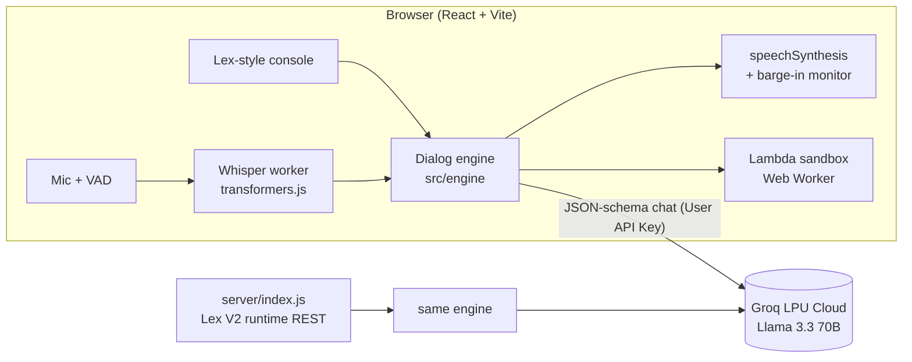

# VoxLex — an Amazon Lex V2 simulator with Groq LLM voice agent

> **AWS Service Simulation & Enhancement** · Service simulated: **Amazon Lex V2** (with Transcribe + Polly pieces)

VoxLex re-implements the Amazon Lex bot builder console and runtime as a web app: intents, sample utterances, slots and slot types, the Lex dialog state machine, Lambda fulfillment, versions & aliases, a test console and a `RecognizeText`-compatible REST API.

On top of that it adds a **voice agent powered by Groq's ultra-fast LPU inference**. Groq (Llama 3.3 70B / Llama 3.1 8B) provides zero-shot NLU, Whisper does speech-to-text in the browser, and the OS voice engine speaks the replies.

### 🔒 Security & Privacy (Zero API Key Exposure)
- **No hardcoded secrets**: No API keys are embedded in source code, environment bundles, or git commits.
- **Client-side isolation**: Each user inputs their own free Groq API key in the UI (**AI Settings** or top bar). The key is stored solely in their browser's `localStorage`.
- **CORS-safe routing**: Requests are proxied via Vite (dev) and Netlify redirect rewrites (production) directly to Groq.

---

## 1. Which Lex features are simulated

| Amazon Lex V2 concept | VoxLex implementation | Where |
|---|---|---|
| Bots (create / list / delete / import) | Bot list with templates and JSON import | `src/pages/BotsList.jsx` |
| Intents + sample utterances with `{Slot}` refs | Intent editor | `src/pages/IntentEditor.jsx` |
| Slots: required/optional, priority, prompts, retries | Slot editor; dialog re-prompts up to 2× then fails | `src/engine/dialog.js` |
| Built-in slot types `AMAZON.Number/Date/Time/City/PhoneNumber/EmailAddress/FirstName/AlphaNumeric/FreeFormInput` | Rule-based resolvers | `src/engine/slotTypes.js` |
| Custom slot types (values + synonyms, *Restrict* / *Expand*) | Exact, synonym and fuzzy (Levenshtein) resolution | `src/engine/slotTypes.js` |
| NLU confidence threshold → `FallbackIntent` | Per-bot threshold slider | `BotSettings.jsx` |
| Dialog management: `ElicitIntent → ElicitSlot → ConfirmIntent → Close` | Full state machine, session attributes, intent switching, built-in cancel | `src/engine/dialog.js` |
| Confirmation prompt / declination response | Supported | |
| Fulfillment Lambda code hook (Lex V2 event/response format) | JS code hook, sandboxed in a Web Worker (browser) or `vm` (server), 3 s timeout, captured logs | `src/engine/lambda.js` |
| Closing response | Supported, with `{Slot}` templating | |
| Versions & aliases (`TestBotAlias` → Draft, `prod` → Version N) | Immutable snapshots, alias routing | `src/pages/Versions.jsx` |
| Test console (text + voice, inspect JSON) | Side panel, shows the `RecognizeText` response | `src/components/TestConsole.jsx` |
| Runtime API `RecognizeText`, `GetSession`, `DeleteSession` | `POST /bots/{id}/botAliases/{alias}/botLocales/{locale}/sessions/{sid}/text` | `server/index.js` |
| Conversation logs (CloudWatch) | Per-turn logs with intent, confidence, latency | `src/pages/Analytics.jsx` |
| Idle session TTL | Session is reset after inactivity | |

## 2. Enhancements beyond AWS

1. **🧠 LLM NLU (zero-shot understanding).** Groq Llama 3.3 reads the bot schema and dialog context and returns intent, confidence and *every* slot it can find in one shot. "yo get me two big paneer pizzas around 8 tonight" fills 4 slots in one turn, where classic Lex falls back.
2. **🎙️ Voice loop with barge-in.** Mic → energy VAD → **Whisper (transformers.js, WebGPU/WASM)** → bot → OS speech synthesis. Hands-free turn-taking, and you can **interrupt the bot mid-sentence**.
3. **⚖️ Classic vs LLM "Compare" mode.** Every turn shows what stock Lex-style matching would have done.
4. **✨ Describe-a-bot generator.** One sentence produces intents, slots, custom slot types, utterances and prompts.
5. **🩺 Missed-utterance coach.** Groq reviews failed turns and proposes which intent each belongs to, as a templated utterance.
6. **💰 Cost & privacy meter.** Each turn is priced at AWS list prices (Lex + Transcribe + Polly + Lambda).
7. **📤 Export to real Amazon Lex.** Downloads a **Lex V2 import package (LexJson zip)** that can be imported into AWS console.

## 3. Architecture



## 4. Running locally

```bash
# 1. Install dependencies
npm install

# 2. Run dev server
npm run dev                    # http://localhost:5173

# 3. Enter your Groq API Key
# Open http://localhost:5173 -> Click "Groq Key Needed" -> Paste your key (from console.groq.com)
```

## 5. Deployment (Netlify)

VoxLex is configured with `netlify.toml` for 1-click Netlify deployment with automatic proxy routing for Groq API calls:

1. **Netlify Drop**: Run `npm run build`, then drag & drop the `dist/` directory onto [app.netlify.com/drop](https://app.netlify.com/drop).
2. **Git Deployment**: Push to GitHub and connect the repository on Netlify. It will automatically build (`npm run build`) and serve `dist/`.
3. Visitors simply enter their own Groq key when they open the live link. No secrets are stored on Netlify.

## 6. Demo script (≈3 min)

1. **Bots → PizzaBot → Intents.** Walk through intents, slots, custom slot types, and the Lambda in *Fulfillment*.
2. **Test bot → Classic.** Type `order a large pepperoni pizza`. The bot elicits the remaining slots, confirms, and the Lambda creates the order.
3. Still Classic: `yo get me two big paneer pizzas around 8 tonight` → **FallbackIntent**.
4. Switch to **Compare**, then send the same sentence. The LLM fills all 4 slots, and the amber chip shows that Classic would have failed.
5. **🎙️ Mic.** Order by voice, then **talk over the bot** to interrupt it.
6. **Logs & coach** → *Analyse missed* → *Add utterance*.
7. **Cost & privacy** shows the AWS bill avoided. Then **Export to AWS** → download the Lex zip.
8. **Create bot → Describe with AI** → "a clinic receptionist that books appointments…"

## 7. Project structure

```
src/
  engine/        dialog.js (Lex state machine) · classicNlu.js · llmNlu.js · llm.js
                 slotTypes.js · lambda.js · generator.js · coach.js · cost.js · exportLex.js · templates.js
  voice/         voiceAgent.js (VAD, TTS, barge-in) · whisper.worker.js
  pages/         console pages (bots, intents, slot types, versions, fulfillment, logs, export, settings, dashboard)
  components/    TestConsole.jsx · ui.jsx
server/          index.js (Lex V2 runtime REST API) · bots/*.json
```

---
*This is a student project for academic purposes. It is not affiliated with or endorsed by Amazon Web Services. "Amazon Lex" is referenced only to describe the service being simulated.*
